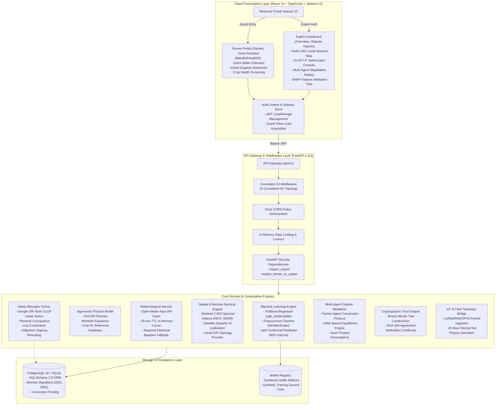

# AQUAMEDI AI — MASTER ARCHITECTURE SPECIFICATION
**Document Reference**: `AQUA-ARCH-2026-V2`  
**System Classification**: Dual-Portal Agricultural Intelligence & Multi-Agent Water Dispute Resolution Platform  
**Target Basin**: Godavari / Mula-Pravara Canal Irrigation District (Ahmednagar, Maharashtra, India)  
**Author**: Principal Software Architect & Core Engineering Team  

---

## 1. High-Level Architectural Vision

AquaMedi AI bridges the critical gap between agricultural physics (FAO-56 Penman-Monteith reference evapotranspiration), empirical machine learning (XGBoost water demand prediction), constrained resource optimization (Google OR-Tools GLOP), and multi-party game-theoretic bargaining.

The architecture strictly segregates into two isolated presentation and privilege tiers:
1. **Farmer Portal**: Frictionless, uncredentialed guest access designed for semi-literate and smallholder farmers, offering voice queries in Marathi, Hindi, and English, smart irrigation recommendations, and symptom-guided crop health diagnostics.
2. **Agricultural Expert Portal**: Authenticated RBAC access designed for water resources engineers, extension officers, and canal magistrates, featuring LP-based allocation optimization, multi-agent dispute mediation, SHAP explainability, and cryptographic Merkle audit certification.

---

## 2. End-to-End System Topology

---

## 3. Component Specifications & Boundaries

### 3.1 Authentication & RBAC Engine
- **Farmer Guest Access**: Uncredentialed issuance of JWTs containing `role: "farmer_guest"` and scoped permissions (`farmer:read`, `farmer:predict`, `farmer:irrigation_advice`).
- **Expert Access**: Authenticated via `/api/v1/auth/expert/login`. Validates credentials against database-backed `users` table with PBKDF2-HMAC-SHA256 password hashing. In development mode, `admin123`/`12345678` is permitted when `enable_dev_demo_credentials=True`.
- **RBAC Boundaries**: Endpoints under `/scenarios/run`, `/conflicts`, `/allocations`, and `/negotiations` strictly enforce `require_expert` (HTTP 403 Forbidden for guest farmers).

### 3.2 Physics & Machine Learning Coupling
- **Physics Layer (`calculate_fao56_et0`)**: Computes reference evapotranspiration $ET_0$ based on radiation balance, psychrometric constant, vapor pressure deficit, and aerodynamic resistance according to FAO Paper 56.
- **Machine Learning Layer (`xgb_model.joblib`)**: High-speed surrogate regressor producing predicted water requirements in $11\text{ ms}$.
- **Uncertainty Layer (`conformal_predictor.py`)**: Computes finite-sample distribution-free prediction intervals $[Q_{lower}, Q_{upper}]$ with 90% statistical confidence.

### 3.3 Hydro-Spatial Optimization Layer
- **Physical Loss Formulation**: Canal discharge loses volume via transit seepage:
  $$\sum_{i=1}^N \frac{x_i}{\eta_i} \le Q_{total}$$
  where $\eta_i = \exp(-k L_i)$ accounts for distance $L_i$ from canal head regulator.
- **Google OR-Tools GLOP**: Maximizes urgency-weighted satisfaction subject to survival lower bounds and conveyance limits.

### 3.4 Multi-Agent Agreement & Cryptographic Ledger
- **Concession Bargaining**: Simulates discrete negotiation rounds where agents with higher relative surplus concede marginal allocations to deficit agents.
- **Cryptographic Merkle Proof**: Computes binary SHA-256 Merkle root across final allocation vectors, generating an immutable verification certificate.
