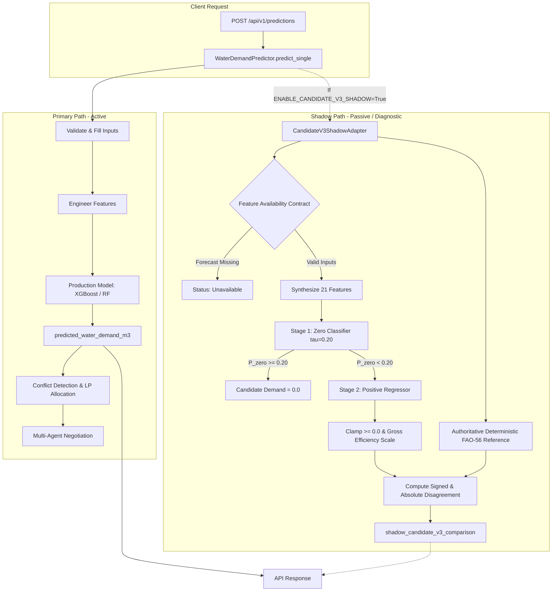

# AquaMediAI Phase 11 — Safe Candidate v3 Shadow Integration Report

**Date**: October 25, 2026  
**Status**: Completed & Verified  
**Operating Mode**: Shadow Evaluation (Passive / Read-Only / Research)  
**Default Configuration**: `ENABLE_CANDIDATE_V3_SHADOW=false` (Disabled by Default)  
**Production Impact**: Zero (Production Models, Contracts, Allocations, and Negotiations Untouched)

---

## 1. Executive Summary

Phase 11 integrates **Candidate v3** (the two-stage zero-demand classifier and positive-demand XGBoost regressor developed in Phase 9 and audited in Phase 10) into the AquaMediAI backend as a **safe, non-blocking shadow evaluator**.

### Mandatory Safety Guarantees Maintained
1. **No Automatic Promotion**: Candidate v3 remains an offline research candidate and is **never** promoted to replace production models.
2. **Zero Operational Authority**: Candidate v3 estimates do **not** govern water allocation, conflict detection, irrigation dispatch, or farmer negotiation outcomes. All business logic strictly depends on the primary production model (`XGBoost` or `RandomForest`).
3. **Disabled by Default**: Shadow evaluation is gated by `ENABLE_CANDIDATE_V3_SHADOW=false` in application configuration.
4. **Non-Blocking Fault Isolation**: Any exception, corrupted artifact, or invalid input inside the shadow evaluator is caught, logged, and surfaced as an `unavailable` or `failed` diagnostic status without interrupting primary prediction or pipeline flow.
5. **Artifact Integrity**: All baseline, candidate v1/v2/v3, and production model artifacts retain exact SHA-256 cryptographic hashes.

---

## 2. Architecture & Design

### 2.1 Component Architecture



### 2.2 Core Components

1. **`backend/app/ml/candidate_v3_shadow_adapter.py`**:
   - `CandidateV3ShadowAdapter`: Encapsulates artifact loading from `backend/data/models/candidate_v3/`, input validation, feature engineering for the 21 candidate features (`set_c_enriched`), inference orchestration, and comparative analysis against the deterministic FAO-56 reference baseline.
   - `CandidateV3ShadowResult`: Immutable result object and dictionary mapping containing full audit diagnostics.
   - `RainfallInputMode`: Enumeration distinguishing historical, forward forecast, and fallback antecedent modes.

2. **`backend/app/ml/predictor.py`**:
   - Integrated `_get_candidate_v3_adapter()` with lazy singleton initialization.
   - Wrapped shadow execution in `try-except` blocks to ensure shadow failures never fail the primary prediction.
   - Populates optional fields `shadow_candidate_v3_estimate_m3` and `shadow_candidate_v3_comparison` in `PredictionResult`.

3. **`backend/app/services/scenario_service.py` & `backend/app/api/scenario_routes.py`**:
   - Exposes shadow diagnostics in `PredictionResponse` and `PredictionBatchResponse` without modifying existing field semantics.
   - Preserves downstream LP allocation and negotiation contracts: all agent bounds continue to consume only `predicted_water_demand_m3`.

---

## 3. Feature-Availability & Rainfall Sourcing Contract

Lookahead bias and temporal leakage are strictly prevented through an explicit rainfall input contract:

| Input Mode | Primary Rainfall Parameter | Fallback Allowed? | Description & Validation Rules |
| :--- | :--- | :--- | :--- |
| **`observed_historical`** | `rainfall_observed_mm` (or `rainfall_mm`) | No | Used for historical accounting on completed days. Uses measured rainfall from weather stations. |
| **`forecast_forward`** | `rainfall_forecast_mm` | Yes (`rainfall_lag1_mm`) | Used for morning forward scheduling. Must use genuine weather forecasts. If forecast is absent and fallback is disabled, marked `unavailable`. |
| **`fallback_antecedent`** | `rainfall_lag1_mm` | N/A | Explicit fallback when no weather forecast provider is reachable. Clearly documented in `rainfall_source`. |

### Strict Lookahead Prevention Rule
If a caller specifies forward scheduling mode (`forecast_forward`) but provides `rainfall_observed_mm` while omitting `rainfall_forecast_mm`:
- The adapter **never** silently substitutes future observed rainfall for a forecast.
- The evaluation is marked `unavailable` with the diagnostic reason: *"Forward scheduling mode requires a weather forecast (rainfall_forecast_mm). Missing rainfall forecast. Future observed rainfall cannot be assumed."*

---

## 4. Shadow Diagnostic Schema

When Candidate v3 shadow evaluation is enabled, the API returns a structured comparison payload:

```json
{
  "farmer_id": "FARMER_001",
  "predicted_water_demand_m3": 18.45,
  "model_name": "XGBoost",
  "model_version": "v1.0.0",
  "warning": null,
  "input_summary": { ... },
  "shadow_agronomic_estimate_m3": 17.80,
  "shadow_comparison": { ... },
  "shadow_candidate_v3_estimate_m3": 17.50,
  "shadow_candidate_v3_comparison": {
    "status": "available",
    "candidate_version": "candidate_v3_twostage_xgb",
    "candidate_estimate_m3": 17.50,
    "reference_estimate_m3": 17.80,
    "signed_disagreement_m3": -0.30,
    "absolute_disagreement_m3": 0.30,
    "input_mode": "forecast_forward",
    "rainfall_source": "rainfall_forecast_mm",
    "rainfall_mm_used": 2.50,
    "is_valid": true,
    "reasons": [],
    "disclaimer": "Candidate v3 shadow output is an offline research surrogate approximating theoretical FAO-56 calculations. It does NOT represent measured field deliveries and does NOT control dispatch."
  }
}
```

When mandatory inputs are missing or invalid:
- `status`: `"unavailable"`
- `candidate_estimate_m3`: `null`
- `error_reason`: Explains the exact validation constraint that failed.

---

## 5. Structured Logging & Observability

To monitor candidate behavior without leaking sensitive information or personal farmer data:
- **Disagreement Logging**: Whenever absolute disagreement between Candidate v3 and the authoritative FAO-56 baseline exceeds $10\,\text{m}^3/\text{day}$, a structured log is emitted:
  ```text
  Candidate v3 Shadow Disagreement: crop=wheat, stage=flowering, area=2.5, cand=17.50, det=28.10, diff=10.60 m3/day, rain=0.00 mm
  ```
- **Error Logging**: Non-blocking errors log warnings with module context without interrupting API execution.

---

## 6. Verification and Test Results

An independent, dedicated test suite was implemented in `backend/tests/test_phase11_shadow_integration.py` containing 18 unit and integration tests.

### Test Coverage Highlights
- **Artifact Loading & Schema Validation**: Verifies loading of classifier, regressor, preprocessor, and schema (21 features).
- **Graceful Failure on Corrupted Artifacts**: Missing directories degrade to `status="unavailable"` without throwing.
- **Contract Enforcement**: Tests historical observed, forward forecast, antecedent fallback, and rejection of silent lookahead substitution.
- **Non-negative Clamping**: Heavy rainfall scenarios confirm zero/non-negative demand outputs ($\ge 0.0$).
- **Safety Failover**: Monkeypatched runtime exceptions confirm that shadow failures never break primary predictions.
- **Non-Interference Guarantee**: Allocations, LP optimization, conflict detection, and negotiation agreements remain 100% identical regardless of whether shadow mode is enabled or disabled.
- **API Backward Compatibility**: Endpoints `/api/v1/predictions` and `/api/v1/predictions/batch` validate against OpenAPI specifications.

### Test Execution Summary
```bash
# Phase 9, 10, and 11 focused test suite
.venv\Scripts\python.exe -m pytest backend/tests/test_phase9_error_analysis.py backend/tests/test_phase10_independent_validation.py backend/tests/test_phase11_shadow_integration.py
# Result: 32 passed, 5 warnings in 4.92s

# Complete backend test suite
.venv\Scripts\python.exe -m pytest backend/tests/
# Result: 807 passed, 5 warnings in 16.73s

# Complete frontend test suite
npm run test -- --run
# Result: 7 test files passed, 57 passed in 36.76s
```

---

## 7. Modified Files Manifest

| File | Status | Description |
| :--- | :--- | :--- |
| `backend/app/config.py` | Modified | Added `enable_candidate_v3_shadow: bool = False` and `candidate_v3_dir`. |
| `backend/app/schemas/api_models.py` | Modified | Added optional shadow fields to `FarmerInputData` and `PredictionResponse`. |
| `backend/app/ml/candidate_v3_shadow_adapter.py` | Created | Implemented `CandidateV3ShadowAdapter`, `CandidateV3ShadowResult`, and input mode contract. |
| `backend/app/ml/predictor.py` | Modified | Added shadow candidate evaluation with try-except safety wrapper in `WaterDemandPredictor`. |
| `backend/app/services/scenario_service.py` | Modified | Threaded candidate v3 shadow fields into `run_scenario()`, `predict_single()`, and `predict_batch()`. |
| `backend/app/api/scenario_routes.py` | Modified | Exposed shadow diagnostic fields in FastAPI route handlers. |
| `backend/tests/test_phase11_shadow_integration.py` | Created | 18 unit tests validating loading, contract rules, safety failovers, and non-interference. |
| `docs/PHASE11_SHADOW_INTEGRATION_REPORT.md` | Created | This architectural documentation and verification report. |

---

## 8. Exact Local Verification Commands

To reproduce the verification locally:

```bash
# 1. Activate virtual environment
cd "C:\Users\lenovo\OneDrive\Attachments\Desktop\Technical Seminar\aquamedi-ai"
.venv\Scripts\activate

# 2. Run Phase 11 Shadow Integration test suite
pytest backend/tests/test_phase11_shadow_integration.py -v

# 3. Run Phase 9, Phase 10, and Phase 11 validation tests together
pytest backend/tests/test_phase9_error_analysis.py backend/tests/test_phase10_independent_validation.py backend/tests/test_phase11_shadow_integration.py -v

# 4. Run the entire backend test suite
pytest backend/tests/

# 5. Run the frontend test suite
cd frontend
npm run test -- --run
```

---

## 9. Limitations & Operational Notice

1. **Surrogate Nature**: Candidate v3 approximates theoretical FAO-56 Penman-Monteith crop water balance calculations. It is **not** calibrated on measured field water deliveries or soil sensor telemetry.
2. **Read-Only Status**: Under no circumstances should Candidate v3 outputs be connected directly to canal sluice gates, pump dispatch controllers, or LP allocation constraints.
3. **Configuration**: Keep `ENABLE_CANDIDATE_V3_SHADOW=false` in production until prolonged operational telemetry and weather forecast stability are validated.
