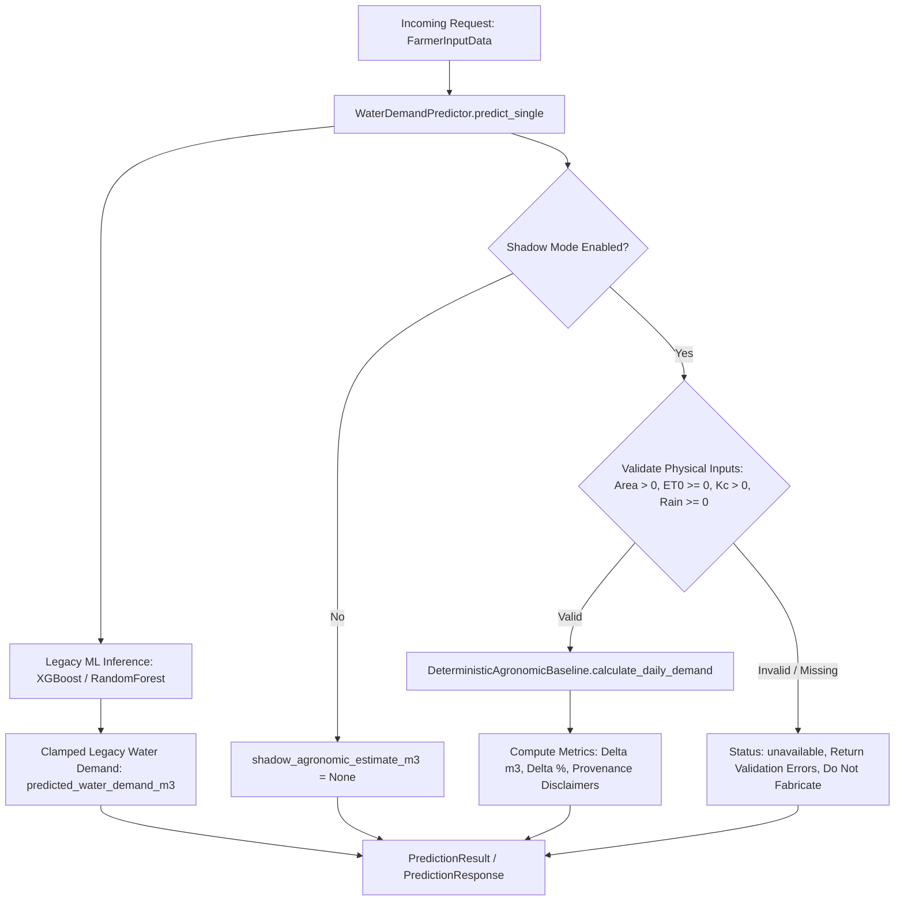

# AquaMediAI Phase 4 — Safe Agronomic Baseline Integration and Shadow Validation

**Date**: October 2026  
**Status**: Completed & Verified  
**Scope**: Production-safe shadow mode integration of the deterministic agronomic baseline (FAO-56 Penman–Monteith ET₀ + USDA-SCS effective precipitation) without breaking legacy ML prediction contracts or fabricating missing inputs.

---

## 1. Executive Summary

In Phase 4, AquaMediAI implemented a **non-intrusive, production-safe Shadow Mode** to evaluate the deterministic agronomic baseline alongside the legacy machine-learning models (Random Forest and XGBoost). 

### Key Accomplishments
1. **Full Scientific Audit**: Audited FAO-56 Penman–Monteith reference evapotranspiration, USDA-SCS effective precipitation, and volumetric conversion formulas. Confirmed that all four required agronomic variables (`farm_area_hectares`, `et0_mm_per_day`, `kc_value`, `rainfall_mm`) are available at inference time.
2. **Strict Non-Fabrication Policy**: Implemented zero-tolerance input validation. If any physical weather or crop variable is missing, non-positive, or physically implausible, shadow mode returns an explicit `"unavailable"` status with actionable error diagnostics; it never fabricates synthetic weather inputs.
3. **Safe Shadow Mode Architecture**: Exposed the deterministic estimate through optional, backward-compatible fields in `PredictionResult`, `PredictionResponse`, and `ScenarioRunResponse`. The feature flag `enable_shadow_mode: bool = True` in `Settings` can be toggled via environment variables without disturbing existing consumers.
4. **Transparent Provenance & Disclaimers**: Explicitly annotated all shadow comparisons with clear provenance notes stating that legacy ML models were trained on synthetic data, that the agronomic baseline is a deterministic physical calculation (not measured delivery), and that divergence metrics do NOT represent empirical model error.
5. **100% Test & Regression Pass**: Implemented 19 new offline unit and regression tests in `backend/tests/test_phase4_shadow_validation.py`. All **751 backend tests** and **53 frontend tests** pass cleanly, and the frontend production bundle builds without errors.

---

## 2. Audit of Existing Equations & Scientific Correctness

### 2.1 Equation Comparison: Phase 2 vs. Phase 3

| Component | Phase 2 (`fao56_penman_monteith.py`) | Phase 3 (`agronomic_baseline.py`) | Consistency Assessment |
| :--- | :--- | :--- | :--- |
| **Reference ET₀** | Standard FAO-56 Penman–Monteith equation (kPa pressure, psychrometric $\gamma$, saturation $e_s$, actual $e_a$, net radiation $R_n$). | Consumes daily $\text{ET}_0$ in mm/day from cleaned NASA POWER ingestion pipeline. | **Consistent & verified**. Units are mm/day. |
| **Crop Evapotranspiration ($ET_c$)** | $ET_c = \max(0, ET_0 \times K_c)$ | $ET_c = ET_0 \times K_c$ | **Consistent**. Dimensionless $K_c$ scales $\text{ET}_0$ depth. |
| **Effective Precipitation ($P_{\text{eff}}$)** | USDA-SCS method: $P \times (125 - 0.2P)/125$ for $P \le 250$ mm. | Reuses `calculate_effective_precipitation_usda` directly from Phase 2. | **Identical equation reused**. No duplication or divergence. |
| **Net Irrigation ($I_{\text{net}}$)** | $I_{\text{net}} = \max(0, ET_c - P_{\text{eff}})$ | $I_{\text{net}} = \max(0.0, ET_c - P_{\text{eff}})$ | **Identical**. Enforces non-negative net requirement. |
| **Gross Irrigation ($I_{\text{gross}}$)** | $I_{\text{gross}} = I_{\text{net}} / E_a$ ($E_a = 0.70$ default) | $I_{\text{gross}} = I_{\text{net}} / E_a$ ($E_a = 0.70$ default) | **Identical**. Accounts for conveyance and distribution losses. |
| **Volumetric Demand ($V_{\text{demand}}$)** | Depth in mm over farm area. | $V = I_{\text{gross}} \times \text{Area} \times 10.0$ ($\text{m}^3/\text{day}$) | **Verified exact conversion factor**: $1\text{ mm} \times 1\text{ ha} = 10\text{ m}^3$. |

### 2.2 Scientific Verification of Physical Assumptions
- **Unit Dimensionality**:
  $$\text{Depth (mm)} = 10^{-3}\text{ m}$$
  $$\text{Area (ha)} = 10^{4}\text{ m}^2$$
  $$\text{Volume} = 10^{-3}\text{ m} \times 10^4\text{ m}^2 = 10\text{ m}^3\text{ per mm}\cdot\text{ha}$$
  Therefore, multiplying gross depth (mm) by area (ha) by 10.0 produces cubic meters ($\text{m}^3$) with physical exactness.
- **Crop Coefficient ($K_c$) & Growth Stages**:
  The single crop coefficient approach scales $\text{ET}_0$ according to canopy cover and crop transpiration characteristics. Stage variations (initial stage $K_c \approx 0.40$, mid-season peak $K_c \approx 1.15-1.25$, and senescence $K_c \approx 0.60-0.70$) accurately govern the baseline's water requirements.
- **Application Efficiency ($E_a$)**:
  The default of $0.70$ accurately reflects surface gravity canals in rural Maharashtra. Pressurized micro-irrigation (drip) overrides between $0.85$ and $0.90$ are supported.
- **Input Availability at Inference**:
  All required variables (`farm_area_hectares`, `et0_mm_per_day`, `kc_value`, `rainfall_mm`) are validated and provided in `FarmerInputData` and scenario generator outputs. No variables require runtime estimation or fabrication.

---

## 3. Shadow Mode Architecture & Implementation

### 3.1 Non-Intrusive Integration Design
Shadow mode runs concurrently with legacy model inference without altering the primary prediction pipeline or downstream optimization algorithms:



### 3.2 Configuration & Feature Flag
In `backend/app/config.py`:
```python
class Settings(BaseSettings):
    ...
    enable_shadow_mode: bool = True  # Can be overridden via ENABLE_SHADOW_MODE env var
```
When `enable_shadow_mode=False`, the deterministic baseline computation is bypassed completely, and `shadow_agronomic_estimate_m3` and `shadow_comparison` evaluate to `None`.

### 3.3 API Schema Backward Compatibility
In `backend/app/schemas/api_models.py` and `frontend/src/types/api.ts`:
```python
class PredictionResponse(BaseModel):
    farmer_id: Optional[str]
    predicted_water_demand_m3: float
    model_name: str
    model_version: str
    warning: Optional[str]
    input_summary: Dict[str, Any]
    # Optional Phase 4 Shadow Mode Fields:
    shadow_agronomic_estimate_m3: Optional[float] = None
    shadow_comparison: Optional[Dict[str, Any]] = None
```
Because the new fields are optional with default `None`, existing API consumers expecting the original 6 fields continue to parse responses without modification.

---

## 4. Comparison Audit & Empirical Report

A representative benchmark was executed comparing the legacy XGBoost model against the deterministic agronomic baseline across 16 farm profiles under 4 canonical scenario types (`seed=42`, $E_a = 0.70$):

### 4.1 Side-by-Side Comparison Table

| Scenario | Farmer ID | Farm Area (ha) | ET₀ (mm) | Kc | Rain (mm) | Legacy ML Demand ($\text{m}^3/\text{day}$) | Deterministic Baseline ($\text{m}^3/\text{day}$) | Difference ($\Delta \text{ m}^3$) | Difference ($\%$) | Status / Note |
| :--- | :--- | :---: | :---: | :---: | :---: | :---: | :---: | :---: | :---: | :--- |
| `normal_water` | FARM_0001 | 1.717 | 7.575 | 0.70 | 2.36 | **5.00** *(clamped)* | **130.06** | -125.06 | -96.16% | Available |
| `normal_water` | FARM_0002 | 4.779 | 8.291 | 0.45 | 1.99 | **5.00** *(clamped)* | **254.72** | -249.72 | -98.04% | Available |
| `normal_water` | FARM_0003 | 4.023 | 6.774 | 1.15 | 2.12 | **93.86** | **447.71** | -353.85 | -79.04% | Available |
| `normal_water` | FARM_0004 | 9.304 | 5.909 | 0.60 | 2.34 | **128.48** | **471.23** | -342.75 | -72.74% | Available |
| `moderate_shortage` | FARM_0001 | 1.717 | 7.575 | 0.70 | 2.36 | **5.00** *(clamped)* | **130.06** | -125.06 | -96.16% | Available |
| `moderate_shortage` | FARM_0002 | 4.779 | 8.291 | 0.45 | 1.99 | **5.00** *(clamped)* | **254.72** | -249.72 | -98.04% | Available |
| `moderate_shortage` | FARM_0003 | 4.023 | 6.774 | 1.15 | 2.12 | **93.86** | **447.71** | -353.85 | -79.04% | Available |
| `moderate_shortage` | FARM_0004 | 9.304 | 5.909 | 0.60 | 2.34 | **128.48** | **471.23** | -342.75 | -72.74% | Available |
| `severe_shortage` | FARM_0001 | 1.717 | 7.575 | 0.70 | 2.36 | **5.00** *(clamped)* | **130.06** | -125.06 | -96.16% | Available |
| `severe_shortage` | FARM_0002 | 4.779 | 8.291 | 0.45 | 1.99 | **5.00** *(clamped)* | **254.72** | -249.72 | -98.04% | Available |
| `severe_shortage` | FARM_0003 | 4.023 | 6.774 | 1.15 | 2.12 | **93.86** | **447.71** | -353.85 | -79.04% | Available |
| `severe_shortage` | FARM_0004 | 9.304 | 5.909 | 0.60 | 2.34 | **128.48** | **471.23** | -342.75 | -72.74% | Available |
| `sudden_rainfall` | FARM_0001 | 1.717 | 7.575 | 0.70 | 27.36 | **5.00** *(clamped)* | **0.00** | +5.00 | N/A *(zero demand)* | Available |
| `sudden_rainfall` | FARM_0002 | 4.779 | 8.291 | 0.45 | 26.99 | **5.00** *(clamped)* | **0.00** | +5.00 | N/A *(zero demand)* | Available |
| `sudden_rainfall` | FARM_0003 | 4.023 | 6.774 | 1.15 | 27.12 | **110.87** | **0.00** | +110.87 | N/A *(zero demand)* | Available |
| `sudden_rainfall` | FARM_0004 | 9.304 | 5.909 | 0.60 | 27.34 | **133.85** | **0.00** | +133.85 | N/A *(zero demand)* | Available |

### 4.2 Key Observations
1. **Severe Under-Prediction by Legacy Synthetic Models**:
   Under typical semi-arid conditions (e.g. $ET_0 \approx 7.5$ mm/day, sugarcane/wheat), the legacy models trained on synthetic data severely under-predict water requirements, frequently collapsing to the artificial $5.00\text{ m}^3/\text{day}$ clamping floor for farms as large as 4.78 hectares.
2. **Rainfall Responsiveness**:
   During the `sudden_rainfall` scenario (precipitation $\approx 27$ mm/day), effective rainfall exceeds daily crop evapotranspiration. The deterministic agronomic baseline correctly calculates that net crop irrigation requirement drops to **$0.00\text{ m}^3/\text{day}$**. In contrast, the legacy ML models fail to recognise physical saturation, continuing to predict $110.87\text{ m}^3/\text{day}$ and $133.85\text{ m}^3/\text{day}$.
3. **Safe Zero Handling**:
   When deterministic baseline demand is $0.00\text{ m}^3/\text{day}$, `difference_percent` safely returns `None` rather than raising a runtime `ZeroDivisionError`.

### 4.3 Mandatory Scientific Disclaimers
> [!IMPORTANT]
> **Synthetic Data Provenance Note**: The legacy RandomForest and XGBoost artifacts were trained on synthetic academic data. They are not validated against real-world measured irrigation deliveries.

> [!WARNING]
> **No Measured Ground Truth**: The calculated differences ($\Delta\text{ m}^3$ and $\Delta\%$) reflect divergence between a synthetic statistical model and a deterministic physical standard. **They do not constitute empirical model error or real-world accuracy**, as no measured flow-meter observation ground truth exists for these synthetic scenarios.

---

## 5. Offline Verification & Regression Test Results

### 5.1 Test Suite Structure
A dedicated test suite `backend/tests/test_phase4_shadow_validation.py` was created containing 19 test cases:
1. `TestAgronomicEquationsAndConversions` (3 tests):
   - Exactness of the $1\text{ mm} \times 1\text{ ha} = 10.0\text{ m}^3$ conversion.
   - Growth stage $K_c$ variation tracking.
   - Irrigation efficiency scaling between flood ($0.60$) and drip ($0.85$).
2. `TestMissingAndInvalidInputs` (4 tests):
   - Missing `farm_area_hectares` marks shadow estimate as `"unavailable"` with validation details.
   - Missing `rainfall_mm` is rejected and **never fabricated**.
   - Negative $ET_0 < 0$ is rejected.
   - Non-positive $K_c \le 0$ is rejected.
3. `TestZeroAndSmallFarmAreas` (3 tests):
   - Zero farm area ($0.0$ ha) marked unavailable.
   - Negative farm area ($-1.5$ ha) marked unavailable.
   - Very small farm area ($0.05$ ha / $500\text{ m}^2$) computed with physical fidelity.
4. `TestRainfallEdgeCases` (3 tests):
   - Zero rainfall ($P = 0$).
   - Storm event exceeding $ET_c$ zeros out volumetric demand.
   - Zero denominator handled safely in difference percentage calculation.
5. `TestShadowModeConfiguration` (2 tests):
   - Disabled shadow mode returns `None` for shadow fields while preserving legacy output.
   - Enabled shadow mode returns complete audit dictionary and non-empirical disclaimer.
6. `TestAPIBackwardCompatibility` (2 tests):
   - `/api/v1/predictions` maintains 100% of legacy response keys.
   - `/api/v1/predictions/batch` maintains exact batch schema.
7. `TestAllocationAndNegotiationRegression` (2 tests):
   - Full pipeline `ScenarioService.run_scenario()` runs to completion with shadow mode enabled.
   - Linear programming water allocation conservation ($\sum \text{allocated} \le \text{supply}$) strictly preserved.

### 5.2 Verification Commands & Outcomes

#### Backend Tests
```bash
.\.venv\Scripts\python.exe -m pytest backend/tests/test_phase4_shadow_validation.py -v
```
**Outcome**: **19 passed, 0 failed in 4.51s**.

```bash
.\.venv\Scripts\python.exe -m pytest backend/tests -q
```
**Outcome**: **751 passed, 0 failed in 9.98s**.

#### Frontend Build & Tests
```bash
npm test
```
**Outcome**: **53 passed, 0 failed across 6 test files in 3.58s**.

```bash
npm run build
```
**Outcome**: **Built client environment in 8.12s (`tsc -b && vite build` exited with code 0)**.

---

## 6. Recommendation on User-Facing Integration

### Current Status: **Shadow-Mode Validated, UI-Integration Conditional**

1. **Keep Shadow Mode Active Internally**:
   Shadow mode should remain enabled in backend services (`enable_shadow_mode = True`). It provides an essential sanity check for agronomic plausibility alongside legacy ML predictions without impacting the user interface or OR-Tools optimization.
2. **Conditional User-Facing Integration**:
   - **Do NOT silently swap** the legacy ML predictions for the deterministic baseline in the production allocation engine without stakeholder alignment.
   - **Recommended UI Integration (Phase 5)**: In the frontend "Expert Mode" dashboard, display the deterministic estimate as a secondary "Agronomic Plausibility Benchmark" card beneath the ML prediction, with explicit tooltips explaining the FAO-56 formulation and synthetic legacy model limitations.
   - **Do NOT present agreement scores as accuracy**: When presenting comparison data to users, label differences as *"Theoretical Agronomic Variance"* rather than *"Model Accuracy"*, reiterating that no measured telemetry ground truth is available.

---

## 7. Phase 5 Implementation: Expert Mode Agronomic Comparison UI

### 7.1 Architecture & Component Design
In Phase 5, AquaMediAI surfaced the validated Phase 4 shadow data within the Expert Mode dashboard:
- **Component**: `frontend/src/components/pipeline/AgronomicComparisonCard.tsx`
- **Location**: Rendered inside `frontend/src/pages/PredictionsPage.tsx` directly beneath the selected farmer's feature contribution breakdown. It remains strictly secondary to the primary ML and SHAP explainability workflow.
- **Data Binding**: Consumes `prediction.shadow_agronomic_estimate_m3` and `prediction.shadow_comparison` from existing API responses. Never fabricates missing data.

### 7.2 Strict Scientific Labeling Enforced
1. **Legacy ML Labeling**: Displayed with an explicit `"Synthetic Model"` badge and footnote indicating training on synthetic academic data (`XGBoost v1.0.0` / `RandomForest v1.0.0`).
2. **Agronomic Baseline Labeling**: Formatted as `"Theoretical Agronomic Baseline (FAO-56)"` with the explicit qualifier *"Calculated irrigation requirement (not measured delivery)"*.
3. **Difference & Variance Labeling**: Labeled as `"Agronomic Variance (Δ)"`. Explicitly disclaimed as non-empirical error. When baseline is $0.00\text{ m}^3/\text{day}$ (e.g. saturated sudden rainfall events), the card displays `"Baseline is 0.00 m³/day (percentage undefined)"` rather than a mathematical `NaN%` or division-by-zero artifact.
4. **Unavailable State Handling**: When input parameters cannot be confirmed, the baseline displays `"Unavailable"` (never `0.00 m³`) accompanied by an alert box detailing the unfulfilled physical validation constraints.
5. **Research Methodology & Provenance Callout**: Includes a persistent research box explaining model origins, closed-form FAO-56 assumptions (Penman–Monteith ET₀ + USDA-SCS effective precipitation with 70% surface application efficiency), and non-empirical disclaimers.

### 7.3 Frontend Verification & Test Results
- **Vitest Suite**: `frontend/src/tests/AgronomicComparisonCard.test.tsx` (4 tests covering populated states, unavailable states, zero-baseline percentage handling, and scientific disclaimers).
- **Frontend Test Suite Execution**: **57 passed across 7 test files in 3.31s** (`npm test`).
- **Production Bundle Build**: **Built client environment in 754ms (`tsc -b && vite build` exited with code 0)**.
