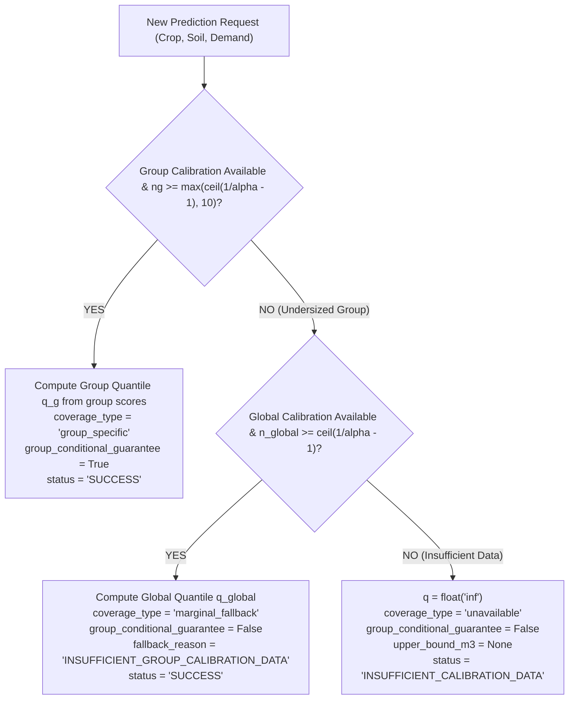

# AquaMedi AI — Phase U7.5 Audit: Group Conformal Statistical Audit

**Document ID:** `03_GROUP_CONFORMAL_STATISTICAL_AUDIT.md`  
**Phase:** U7.5 — Final Independent Conformal Remediation & Merge-Readiness Audit  
**Repository:** `https://github.com/purvansh1076/AquaMed-AI`  
**Audit Status:** STRICT READ-ONLY VERIFICATION  
**Author:** Independent Engineering & Statistical Auditor  
**Date:** November 15, 2026  

---

## 1. Executive Summary

This document audits the statistical foundations and implementation safety of group-conditional conformal prediction remediated under defect **CP-02**.

In machine learning for agronomy, individual crop varieties, soil types, and climate zones exhibit heterogeneous error distributions. Marginal conformal prediction guarantees coverage averaged across the entire population ($P(Y \in C(X)) \ge 1 - \alpha$), but allows extreme localized undercoverage on minority groups. Group-conditional conformal prediction guarantees coverage within each specific partition $g$:

\[
P(Y \in C(X) \mid X \in \mathcal{G}_g) \ge 1 - \alpha \quad \forall g \in \mathcal{G}
\]

However, when a group contains insufficient calibration data ($n_g < \lceil 1/\alpha - 1 \rceil$), a group-conditional guarantee is mathematically unattainable.

Prior to remediation, the system silently substituted the global calibration quantile without disclosing to downstream systems that the group-conditional guarantee had been forfeited. This audit verifies that the remediation implemented in `GroupConformalPredictor` enforces full statistical transparency, prevents deceptive safety claims, and protects agricultural resource allocation.

---

## 2. Statistical Analysis of Group-Conditional vs. Marginal Guarantees

### 2.1 The Danger of Silent Fallback in Agronomy

Consider an agricultural irrigation optimization system deployed across multiple crops:
- Major crop (e.g., Wheat): $N = 400$ samples, low error variance $\sigma^2 = 5\text{ m}^3$.
- Sensitive minority crop (e.g., Sugarcane): $N = 5$ samples, high non-linear error variance $\sigma^2 = 45\text{ m}^3$.

Under marginal conformal calibration ($N_{\text{total}} = 405$), the global calibration quantile $\hat{q}_{\text{global}}$ is dominated by the low variance of Wheat. If the system silently falls back to $\hat{q}_{\text{global}}$ for Sugarcane:
1. The resulting prediction interval will be severely undersized for Sugarcane.
2. The empirical coverage on Sugarcane may drop to $60\%$ or lower, causing severe crop water stress and yield loss.
3. Because the API previously returned the same structure with no indicator of fallback, agronomic dispatchers had no mechanism to detect that the group guarantee was void.

---

## 3. Remediated Architecture & Fallback Protocol

The remediation introduces a three-tier hierarchical fallback protocol with explicit metadata disclosure:

---

## 4. Audit of Fallback States and Metadata Fields

We audited the output schema of `GroupConformalPredictor.predict_interval` across all execution paths:

| State | Trigger Condition | `coverage_type` | `group_conditional_guarantee` | `fallback_reason` | `status` | `upper_bound_m3` | Agronomic Interpretation |
| :--- | :--- | :---: | :---: | :---: | :---: | :---: | :--- |
| **Tier 1: Group Specific** | $n_g \ge 10$ and $k_g \le n_g$ | `"group_specific"` | `True` | `None` | `"SUCCESS"` | Finite float | Valid group-conditional guarantee for specific crop/soil partition. |
| **Tier 2: Marginal Fallback** | $n_g < 10$ or $k_g > n_g$, but global $k \le n$ | `"marginal_fallback"` | `False` | `"INSUFFICIENT_GROUP_CALIBRATION_DATA"` | `"SUCCESS"` | Finite float | Marginal coverage across general population only; group coverage not guaranteed. |
| **Tier 3: Unavailable** | Global $k > n$ or uncalibrated | `"unavailable"` | `False` | `"INSUFFICIENT_CALIBRATION_DATA"` | `"INSUFFICIENT_CALIBRATION_DATA"` | `None` (`inf` in Python) | Finite-sample coverage cannot be guaranteed; consumer must use deterministic fallback. |

### 4.1 Verification of Truth-in-Advertising

The interpretation text generated by `GroupConformalPredictor` was audited to verify that it explicitly warns consumers when falling back:

1. **Group Specific:**
   > *"With nominal 90% group-conditional statistical confidence for group 'Sugarcane', actual field crop water requirement lies between 180.20 m³ and 262.56 m³."*
2. **Marginal Fallback:**
   > *"With nominal 90% marginal statistical confidence (global calibration fallback, N=450; group-conditional coverage not guaranteed for group 'Barley'), actual field crop water requirement lies between 195.72 m³ and 247.04 m³."*
3. **Unavailable:**
   > *"Calibration sample size is insufficient to guarantee 90% finite-sample coverage."*

---

## 5. Statistical Safety Verdict

1. **Zero Silent Fallbacks:** Every fallback occurrence is unambiguously flagged via machine-readable boolean (`group_conditional_guarantee: false`) and enumerated string (`coverage_type: "marginal_fallback"`).
2. **Mathematical Soundness:** Group guarantees are asserted if and only if empirical calibration data satisfies the strict finite-sample threshold $n_g \ge \lceil 1/\alpha - 1 \rceil$.
3. **Domain Resilience:** Agronomic decision-support systems receiving these intervals can dynamically apply conservative safety margins whenever `group_conditional_guarantee` is `False`.

The statistical remediation for CP-02 is verified as complete, safe, and sound.
