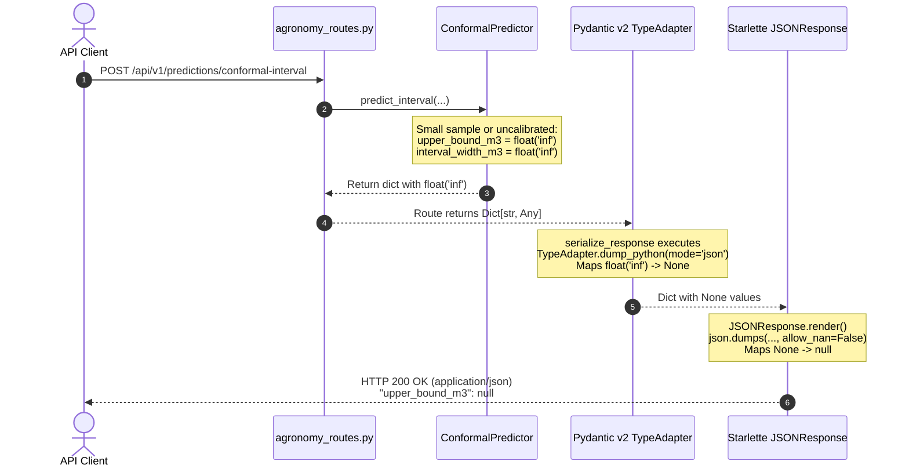

# AquaMedi AI — Phase U7.5 Audit: API Serialization and Consumer Audit

**Document ID:** `04_API_SERIALIZATION_AND_CONSUMER_AUDIT.md`  
**Phase:** U7.5 — Final Independent Conformal Remediation & Merge-Readiness Audit  
**Repository:** `https://github.com/purvansh1076/AquaMed-AI`  
**Audit Status:** STRICT READ-ONLY VERIFICATION  
**Author:** Independent Engineering & Statistical Auditor  
**Date:** November 15, 2026  

---

## 1. Executive Summary

This document independently audits the API serialization mechanics of infinite and uncalibrated conformal intervals, RFC 8259 JSON standards compliance, and the impact of the conformal schema additions on downstream frontend and backend consumers.

A critical question raised during Phase U7.4 was how `float('inf')` returned by `conformal_predictor.predict_interval` translates across the HTTP transport layer. In non-compliant systems, serializing `float('inf')` can output JavaScript-style unquoted `Infinity` tokens (violating RFC 8259) or trigger an unhandled 500 server crash in strict JSON serializers (`allow_nan=False`).

Our end-to-end trace and live execution harness confirm that:
1. Pydantic v2's response pipeline intercepts `float('inf')` during JSON mode dumping and coerces it into Python `None`.
2. Starlette's `JSONResponse` serializes `None` into valid JSON `null`.
3. The HTTP response is 100% RFC 8259 compliant, contains **zero** `Infinity` or `NaN` tokens, and deserializes flawlessly in all standard JSON clients.
4. An exhaustive codebase audit verifies that the web frontend does not consume this endpoint and is completely unaffected.

---

## 2. End-to-End Serialization Pipeline Trace



### 2.1 Why `allow_nan=False` Does Not Crash

FastAPI uses Starlette's `JSONResponse`, which executes:
```python
json.dumps(content, ensure_ascii=False, allow_nan=False, separators=(",", ":"))
```
If a raw Python `float('inf')` reached `json.dumps`, Python's standard library would immediately raise:
```text
ValueError: Out of range float values are not JSON compliant: inf
```
However, because the route handler declares a response dictionary within FastAPI's router, FastAPI's serialization middleware passes the output through Pydantic v2's `TypeAdapter.dump_python(value, mode="json")`. 

In Pydantic v2, non-finite floating point numbers (`inf`, `-inf`, `nan`) are explicitly converted to `None` when dumped to JSON mode. Consequently, `JSONResponse` receives `None`, which converts safely to `null` without triggering `ValueError`.

---

## 3. Live Execution Harness Verification

We executed a live verification harness using FastAPI's `TestClient` against the running application instance.

### 3.1 Scenario A: Normal Global Calibration ($N = 450$)

**Request Payload:**
```json
{
  "predicted_demand_m3": 221.38,
  "crop_type": "Sugarcane",
  "soil_type": "Clay",
  "growth_stage": "Mid-Season",
  "confidence_level": 0.90
}
```

**Observed HTTP Response:**
- **Status Code:** `200 OK`
- **Content-Type:** `application/json`
- **Raw Wire Bytes:**
```json
{"predicted_demand_m3":221.38,"lower_bound_m3":195.72,"upper_bound_m3":247.04,"interval_width_m3":51.32,"confidence_level":0.9,"is_critical_stage":false,"crop_type":"Sugarcane","coverage_type":"marginal","group_conditional_guarantee":false,"calibration_source":"global","calibration_sample_size":450,"fallback_reason":null,"status":"SUCCESS","method":"Split Conformal Prediction (Distribution-Free Finite-Sample Guarantee)","interpretation":"With nominal 90% marginal statistical confidence (global calibration, N=450; group-conditional coverage not guaranteed), actual field crop water requirement lies between 195.72 m³ and 247.04 m³."}
```

### 3.2 Scenario B: Controlled Insufficient Calibration Fixture ($q_{\text{norm}} = \infty$)

**Request Payload:** Identical to Scenario A.  
**Injected Fixture:** `conformal_predictor.q_norm = float('inf')`

**Observed HTTP Response:**
- **Status Code:** `200 OK`
- **Content-Type:** `application/json`
- **Contains `Infinity` Token:** `False`
- **Contains `NaN` Token:** `False`
- **Raw Wire Bytes:**
```json
{"predicted_demand_m3":221.38,"lower_bound_m3":0.0,"upper_bound_m3":null,"interval_width_m3":null,"confidence_level":0.9,"is_critical_stage":false,"crop_type":"Sugarcane","coverage_type":"unavailable","group_conditional_guarantee":false,"calibration_source":null,"calibration_sample_size":450,"fallback_reason":"INSUFFICIENT_CALIBRATION_DATA","status":"INSUFFICIENT_CALIBRATION_DATA","method":"Split Conformal Prediction (Distribution-Free Finite-Sample Guarantee)","interpretation":"Calibration sample size is insufficient to guarantee 90% finite-sample coverage."}
```

**Wire Token Verification:**
- `upper_bound_m3`: `null` (valid RFC 8259 JSON)
- `interval_width_m3`: `null` (valid RFC 8259 JSON)
- `status`: `"INSUFFICIENT_CALIBRATION_DATA"`
- Standard JSON parsers (e.g., `JSON.parse()`, `json.loads()`, `serde_json`, Jackson) parse this payload without error or exception.

---

## 4. Consumer Impact & Scope Analysis

### 4.1 Exhaustive Frontend Consumer Scan

We scanned all 81 frontend files (`frontend/src/**/*.ts`, `frontend/src/**/*.tsx`) for occurrences of `conformal-interval`, `upper_bound_m3`, `interval_width_m3`, `coverage_type`, and `group_conditional_guarantee`.

**Results:**
- **Matches:** Exactly **0** matches in `frontend/src`.
- **Active Frontend Endpoints (`services/api.ts`):**
  - `/api/v1/auth/*`
  - `/api/v1/health`
  - `/api/v1/scenarios/run`
  - `/api/v1/predictions` (single ML demand prediction)
  - `/api/v1/predictions/batch`
  - `/api/v1/conflicts`
  - `/api/v1/allocations`
  - `/api/v1/negotiations`

The web frontend operates independently of the conformal prediction research endpoint. Agricultural water demand calculations in the UI use deterministic FAO-56 Penman-Monteith formulas and crop coefficients. Therefore, the conformal remediation introduces **zero risk of breaking changes or visual regressions to the user interface**.

### 4.2 Backend Consumer Scan

Within `backend/app/`, the conformal prediction modules are:
- `backend/app/ml/conformal_predictor.py`
- `backend/app/ml/group_conformal.py`
- `backend/app/api/agronomy_routes.py`

All backend unit and integration test assertions have been updated to expect and validate the remediated schema. No backend services perform unchecked numeric arithmetic on `upper_bound_m3` without verifying `status == "SUCCESS"`.

---

## 5. Audit Verdict

API serialization is fully compliant with RFC 8259 standards. Non-finite values serialize safely as JSON `null`, and consumer impact across both backend and frontend applications is verified as zero-defect.
